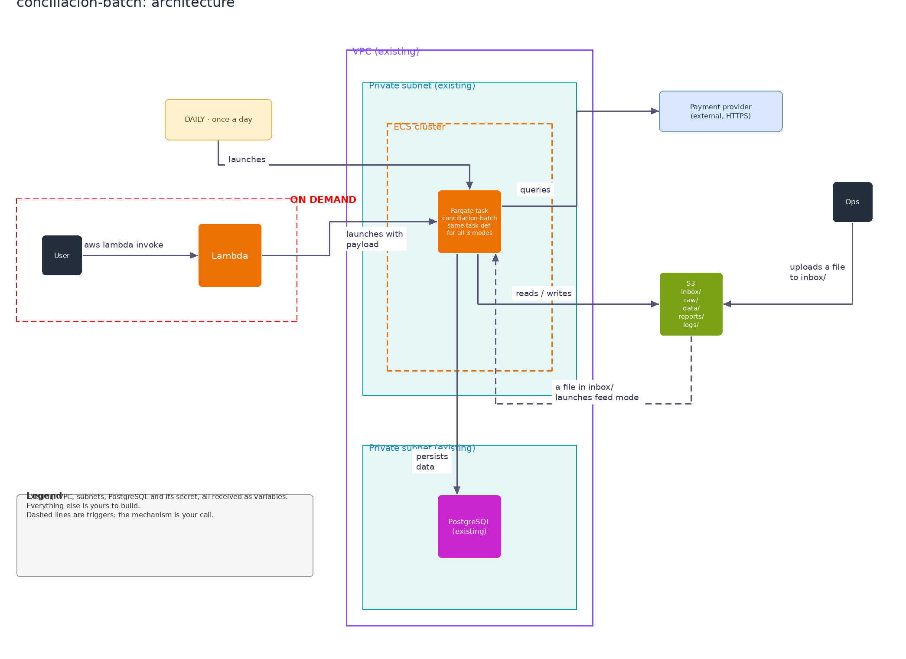

# Technical exercise: `conciliacion-batch`

> **A note on language.** This repository and the challenge brief were originally written in
> Spanish by the Job Technical Senior DevOps interviewer who authored the exercise. To unify the
> project, the whole documentation set — the `README`s, the code and Terraform comments, and the
> architecture diagram — was translated into English. The exercise itself has not changed: the
> requirements, the deliverables and the intent are exactly the ones the interviewer wrote. Only the
> language is new.
>
> Two things were deliberately left in their original form. Values the code depends on (the `RUN_MODE`
> values, the feed CSV header, the reconciliation states, the S3 prefixes, resource names) are the
> application contract, not prose. User-facing runtime strings (log lines, error messages, email
> subjects and bodies) were also left untouched, so that the evidence quoted in
> [`docs/verification.md`](docs/verification.md) still matches exactly what the code prints.
>
> The translation was produced with an AI assistant (Hermes).

> **Delivery:** the guide to stand the stack up and validate it (the three triggers and the email) is
> in [`infra/README.md`](infra/README.md); the diagram of what was built is in
> [`docs/flow.svg`](docs/flow.svg).

## How this exercise works

1. **Before the interview** you get read access to this repository. Read it calmly; you do not need to install or build anything yet.
2. **In the interview** we answer your questions and you design the solution out loud (you can draw over `docs/arquitectura.drawio`).
3. **After the interview** you build the solution. You have **3 days** to deliver it (see [How to deliver](#how-to-deliver)).
4. It is normal to change something you designed in the interview once you start building. Just tell us **what changed and why**.

## Context

We have a payment reconciliation batch process that runs as a task on **ECS Fargate**. The same process runs in three ways:

1. **Daily:** once a day, on a schedule.
2. **On demand:** a user invokes a Lambda with the AWS CLI and the Lambda starts the task with a payload (for example, a date range).
3. **By file (feed):** when operations uploads a file of movements to the bucket's `inbox/` folder, that file is processed automatically. The file feeds data into the process; it is not an order to reconcile.

The application is already written (`app/`). Your job is the infrastructure, the Lambda and the pipeline that make it run.



The diagram is also available as `docs/arquitectura.drawio` in case you want to edit it.

## What already exists

These resources already exist in the AWS account, managed by another team. **Do not create them**: you will receive their identifiers as variables.

- A VPC with private subnets that reach the internet through NAT.
- A PostgreSQL database.
- A secret in Secrets Manager with the database credentials.
- The database security group.

To work locally, `bootstrap-floci/` creates these same resources on [Floci](https://github.com/floci-io/floci) (a local AWS emulator) and gives you their identifiers.

You can also use an AWS account of your own. In that case, `bootstrap-floci/` is there to create the "existing" resources in it (without `AWS_ENDPOINT_URL`). Keep in mind that on a real account the NAT and the database cost money: destroy everything when you are done.

## What we need

Using **Terraform** (the `infra/` folder), build everything still missing for the process to work:

1. The ECS Fargate task that runs the `app/` image.
2. The scheduled **daily** run.
3. The **on-demand** run: a Python Lambda (code in `lambda/`) that receives a payload and starts the task with it.
4. The **file-triggered** run: when a file is uploaded to `inbox/`, the task runs in `feed` mode with that file.
5. The S3 bucket the application uses.
6. **Notifications:** operations needs to find out when any run finishes, whether it succeeded or failed. Design the mechanism and explain why you chose it.

The application contract (environment variables, what it reads and writes, exit codes, feed file format) is in [`app/README.md`](app/README.md).

### Pipeline (GitHub Actions)

In `.github/workflows/`:

- On every **pull request**: validate the application and the infrastructure.
- On **merge to `main`**: publish the image and leave the new task version ready.

You do not need the pipeline to run against a real account, but it must be ready to do so.

### Key requirement: reproducibility

We will review your solution by applying it **in another AWS account, filling in variables only**. Your Terraform must work on Floci and on a real account **without changing the code**, and it must be fully creatable and destroyable with no manual steps. If a manual step is unavoidable, document it.

## Priorities

If you run out of time, prioritise in this order:

1. **Essential:** the three execution paths work, the application writes to S3 and to the database, operations finds out about the result, and the README lets us deploy without asking you anything.
2. **Pipeline:** also required, but we accept it incomplete as long as you explain what is missing.
3. **Everything else:** any improvement you think is worth it. Tell us why.

If something is left incomplete, document it. We value a well-explained decision more than a complete solution with no justification.

## What to deliver

- `infra/`: your Terraform.
- `lambda/`: the Lambda code.
- `.github/workflows/`: your pipeline.
- A **README** (you may replace this file or create a new one) with:
  - how to deploy from scratch, on Floci and on AWS;
  - how to trigger the on-demand run with a sample payload and how to test the file-triggered run;
  - which decisions you made and why;
  - what changed relative to the design we did in the interview and why;
  - what you could not test and what you would improve with more time;
  - which AI assistants you used and for what, if you used any.

You may modify `app/` if you need to; if you do, explain the change.

### How to deliver

Work on a clone of this repository, preserving its history, and push it to a **private** repository on your GitHub account:

```bash
git clone <url of this repository>
cd conciliacion-batch-challenge
# create an empty private repository on GitHub (no README) and point it as origin
git remote set-url origin https://github.com/<your-user>/<your-repository>.git
git push -u origin main
```

When you finish, invite the GitHub account we give you in the email as a collaborator and reply to us with the link. Do not make the repository public.

Read access to this repository is revoked after the interview; clone it before then.

## Local environment

Requirements: Docker and Docker Compose, Terraform 1.16.x, AWS CLI v2.

```bash
# Start Floci (pinned version in docker-compose.yml)
docker compose up -d

# Point Terraform and the AWS CLI at Floci
export AWS_ENDPOINT_URL=http://localhost:4566
export AWS_ACCESS_KEY_ID=test
export AWS_SECRET_ACCESS_KEY=test
export AWS_REGION=us-east-1

# Create the "existing" resources
cd bootstrap-floci && terraform init && terraform apply
```

If you would rather not install Terraform and the AWS CLI, `.docker/` ships a container with both, already pointed at Floci (`.docker/floci.env`). From the repository root, with Floci running:

```bash
docker compose -f .docker/compose.yaml run --rm cli terraform -chdir=bootstrap-floci init
docker compose -f .docker/compose.yaml run --rm cli terraform -chdir=bootstrap-floci apply
docker compose -f .docker/compose.yaml run --rm cli aws s3 ls
```

To use it with your own AWS account, create another variables file next to `floci.env` (without `AWS_ENDPOINT_URL`) and pass it with `CLI_ENV_FILE=my-account.env`. The container also mounts `~/.aws` (read-only).

Details in [`bootstrap-floci/README.md`](bootstrap-floci/README.md). Floci runs ECS tasks and Lambdas as real Docker containers, so you can test the whole flow without an AWS account.

## AI usage

You may use AI assistants. State in your README which ones you used and for what. We will ask you to explain any part of your solution.

## Questions

If anything in the brief is unclear, ask us: in the interview, or afterwards by replying to the email we sent you the exercise with. Asking is part of the exercise too. If you would rather assume something, write the assumption down in your README.
