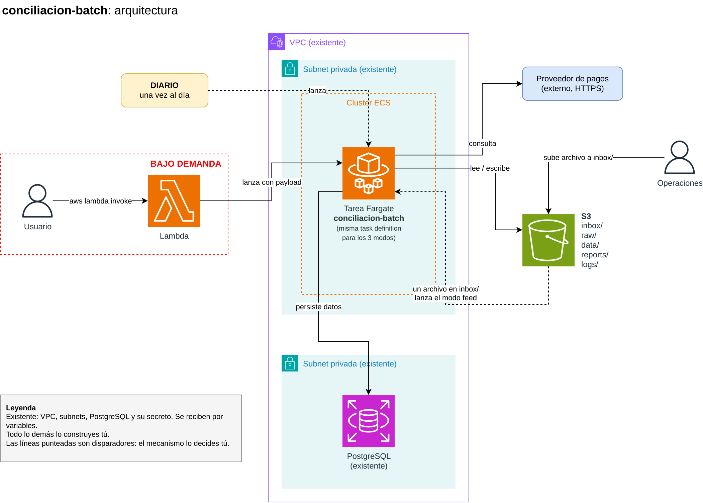

# Ejercicio técnico: `conciliacion-batch`

## Cómo funciona este ejercicio

1. **Antes de la entrevista** recibes acceso de lectura a este repositorio. Léelo con calma; no necesitas instalar ni construir nada todavía.
2. **En la entrevista** resolvemos tus dudas y diseñas la solución en voz alta (puedes dibujar sobre `docs/arquitectura.drawio`).
3. **Después de la entrevista** construyes la solución. Tienes **3 días** para entregarla (ver [Cómo entregar](#cómo-entregar)).
4. Es normal que al construirla cambies algo de lo que diseñaste en la entrevista. Solo cuéntanos **qué cambió y por qué**.

## Contexto

Tenemos un proceso batch de conciliación de pagos que corre como tarea en **ECS Fargate**. El mismo proceso se ejecuta de tres formas:

1. **Diaria:** una vez al día, de forma programada.
2. **Bajo demanda:** un usuario invoca una Lambda con la AWS CLI y la Lambda lanza la tarea con un payload (por ejemplo, un rango de fechas).
3. **Por archivo (feed):** cuando operaciones sube un archivo de movimientos a la carpeta `inbox/` del bucket, ese archivo se procesa automáticamente. El archivo alimenta de datos al proceso; no es una orden de conciliar.

La aplicación ya está escrita (`app/`). Tu trabajo es la infraestructura, la Lambda y el pipeline que la ponen a funcionar.



El diagrama también está en `docs/arquitectura.drawio` por si quieres editarlo.

## Qué ya existe

En la cuenta de AWS ya existen estos recursos, administrados por otro equipo. **No los crees**: recibirás sus identificadores como variables.

- Una VPC con subnets privadas que salen a internet por NAT.
- Una base de datos PostgreSQL.
- Un secreto en Secrets Manager con las credenciales de la base de datos.
- El security group de la base de datos.

Para trabajar localmente, `bootstrap-floci/` crea estos mismos recursos en [Floci](https://github.com/floci-io/floci) (un emulador local de AWS) y te entrega sus identificadores.

También puedes usar una cuenta propia de AWS. En ese caso, `bootstrap-floci/` sirve para crear ahí los recursos "existentes" (sin `AWS_ENDPOINT_URL`). Ten en cuenta que en una cuenta real el NAT y la base de datos generan costos: destruye todo al terminar.

## Qué necesitamos

Construye con **Terraform** (carpeta `infra/`) todo lo que falta para que el proceso funcione:

1. La tarea de ECS Fargate que ejecuta la imagen de `app/`.
2. La ejecución **diaria** programada.
3. La ejecución **bajo demanda**: una Lambda en Python (código en `lambda/`) que recibe un payload y lanza la tarea con él.
4. La ejecución **por archivo**: cuando se sube un archivo a `inbox/`, la tarea se ejecuta en modo `feed` con ese archivo.
5. El bucket de S3 que usa la aplicación.
6. **Notificaciones:** operaciones necesita enterarse cuando termina cualquier ejecución, tanto si salió bien como si falló. Diseña el mecanismo y explica por qué lo elegiste.

El contrato de la aplicación (variables de entorno, qué lee y escribe, códigos de salida, formato del archivo de feed) está en [`app/README.md`](app/README.md).

### Pipeline (GitHub Actions)

En `.github/workflows/`:

- En cada **pull request**: validar la aplicación y la infraestructura.
- Al hacer **merge a `main`**: publicar la imagen y dejar lista la nueva versión de la tarea.

No necesitas que el pipeline corra contra una cuenta real, pero debe estar listo para hacerlo.

### Requisito clave: reproducibilidad

Revisaremos tu solución aplicándola **en otra cuenta de AWS, solo llenando variables**. Tu Terraform debe funcionar en Floci y en una cuenta real **sin modificar el código**, y debe poder crearse y destruirse por completo sin pasos manuales. Si algún paso manual es inevitable, documéntalo.

## Prioridades

Si no te alcanza el tiempo, prioriza en este orden:

1. **Indispensable:** las tres formas de ejecución funcionan, la aplicación escribe en S3 y en la base de datos, operaciones se entera del resultado y el README permite desplegar sin preguntarte nada.
2. **Pipeline:** también se pide, pero lo aceptamos incompleto si explicas qué falta.
3. **Lo demás:** cualquier mejora que creas que vale la pena. Cuéntanos por qué.

Si algo queda incompleto, documéntalo. Valoramos más una decisión bien explicada que una solución completa sin justificar.

## Qué entregar

- `infra/`: tu Terraform.
- `lambda/`: el código de la Lambda.
- `.github/workflows/`: tu pipeline.
- Un **README** (puedes reemplazar este archivo o crear uno nuevo) con:
  - cómo desplegar desde cero, en Floci y en AWS;
  - cómo lanzar la ejecución bajo demanda con un payload de ejemplo y cómo probar la ejecución por archivo;
  - qué decisiones tomaste y por qué;
  - qué cambió respecto al diseño que hicimos en la entrevista y por qué;
  - qué no pudiste probar y qué mejorarías con más tiempo;
  - qué asistentes de IA usaste y para qué, si usaste alguno.

Puedes modificar `app/` si lo necesitas; si lo haces, explica el cambio.

### Cómo entregar

Trabaja sobre un clon de este repositorio, conservando su historial, y súbelo a un repositorio **privado** en tu cuenta de GitHub:

```bash
git clone <url de este repositorio>
cd conciliacion-batch-challenge
# crea en GitHub un repositorio privado vacío (sin README) y apúntalo como origin
git remote set-url origin https://github.com/<tu-usuario>/<tu-repositorio>.git
git push -u origin main
```

Al terminar, invita como colaborador a la cuenta de GitHub que te indicamos en el correo y respóndenos con el enlace. No hagas público el repositorio.

El acceso de lectura a este repositorio se retira después de la entrevista; clónalo antes.

## Entorno local

Requisitos: Docker y Docker Compose, Terraform 1.16.x, AWS CLI v2.

```bash
# Levantar Floci (versión fija en docker-compose.yml)
docker compose up -d

# Apuntar Terraform y la AWS CLI a Floci
export AWS_ENDPOINT_URL=http://localhost:4566
export AWS_ACCESS_KEY_ID=test
export AWS_SECRET_ACCESS_KEY=test
export AWS_REGION=us-east-1

# Crear los recursos "existentes"
cd bootstrap-floci && terraform init && terraform apply
```

Si prefieres no instalar Terraform ni la AWS CLI, `.docker/` trae un contenedor con ambos, ya apuntado a Floci (`.docker/floci.env`). Desde la raíz del repositorio, con Floci levantado:

```bash
docker compose -f .docker/compose.yaml run --rm cli terraform -chdir=bootstrap-floci init
docker compose -f .docker/compose.yaml run --rm cli terraform -chdir=bootstrap-floci apply
docker compose -f .docker/compose.yaml run --rm cli aws s3 ls
```

Para usarlo con tu cuenta de AWS, crea otro archivo de variables junto a `floci.env` (sin `AWS_ENDPOINT_URL`) y pásalo con `CLI_ENV_FILE=mi-cuenta.env`. El contenedor también monta `~/.aws` (solo lectura).

Detalles en [`bootstrap-floci/README.md`](bootstrap-floci/README.md). Floci ejecuta las tareas de ECS y las Lambdas como contenedores Docker reales, así que puedes probar el flujo completo sin una cuenta de AWS.

## Uso de IA

Puedes usar asistentes de IA. Indica en tu README cuáles usaste y para qué. Te pediremos explicar cualquier parte de tu solución.

## Dudas

Si algo del enunciado no está claro, pregúntanos: en la entrevista o, después, respondiendo al correo con el que te enviamos el ejercicio. Preguntar también es parte del ejercicio. Si prefieres asumir algo, anota el supuesto en tu README.
