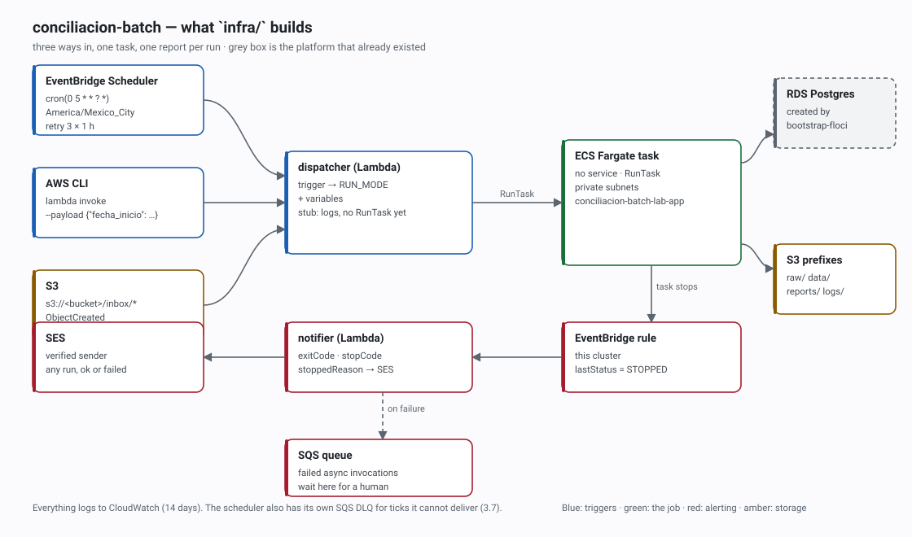

# `infra/` — run it, then check it

Nine files, 58 resources: a batch job that runs three ways, alerts when it stops, and hands four
values to whatever calls it. This page is the short version — what to type, what you should see, and
where to look when you don't.



The three triggers all end in the same `dispatcher` Lambda, which normalises the event into the
`RUN_MODE` the container expects (`daily`, `on_demand`, `feed` — contract in
[`app/README.md`](../app/README.md)). Everything after the task stops is the alerting path.

> **Status.** Every resource below is real and applied; the triggers, the IAM and the alerting are
> proven. The one seam is inside the dispatcher: it translates the event and logs the result, but
> the `ecs:RunTask` call that starts the container is the next piece — the role, the cluster, the
> subnets and the security group are already wired for it. Where that matters, the expected output
> below says so instead of pretending.

---

## The whole run, in order

| # | You do | You should see |
|---|---|---|
| 0 | `docker compose up -d` | `floci` healthy on `:4566` |
| 1 | `terraform -chdir=bootstrap-floci apply` | 5 outputs: the VPC, subnets, database, secret |
| 2 | `terraform -chdir=infra apply` | `Apply complete! Resources: 58 added` |
| 3 | invoke with a scheduler event | `"run_mode": "daily"` |
| 4 | invoke with a payload | `"run_mode": "on_demand"` |
| 5 | upload a CSV to `inbox/` | `RUN_MODE=feed … "INPUT_KEY": "inbox/<file>"` |
| 6 | publish a `STOPPED` task event | `Aviso: [conciliación] FALLA · salida 2` |
| 7 | `terraform -chdir=infra destroy` | `Destroy complete!` |

Steps 0–2 are about ten minutes on a cold machine, provider download included. Steps 3–6 are
copy-paste.

---

## 0. Prerequisites

```bash
terraform version   # >= 1.9
aws --version       # v2
docker version      # compose plugin
```

The emulator accepts any credentials, so these are literals, not secrets. Export them once per
shell — the AWS CLI and Terraform both read them:

```bash
export AWS_ACCESS_KEY_ID=test
export AWS_SECRET_ACCESS_KEY=test
export AWS_DEFAULT_REGION=us-east-1
export AWS_ENDPOINT_URL=http://localhost:4566
```

---

## 1. The platform that "already exists"

In a real account this is another team's VPC, Postgres and secret. Locally,
[`bootstrap-floci/`](../bootstrap-floci) creates the same five things so `infra/` can consume them
instead of inventing them.

```bash
docker compose up -d
terraform -chdir=bootstrap-floci init
terraform -chdir=bootstrap-floci apply
terraform -chdir=bootstrap-floci output
```

```
db_endpoint          = "floci:7001"
db_secret_arn        = "arn:aws:secretsmanager:us-east-1:000000000000:secret:conciliacion-batch/db-credentials-XXXXXX"
db_security_group_id = "sg-XXXXXXXXXXXXXXXXX"
subnet_ids           = ["subnet-XXXXXXXXXXXXXXXXX", "subnet-XXXXXXXXXXXXXXXXX"]
vpc_id               = "vpc-XXXXXXXXXXXXXXXXX"
```

Hand those values to `infra/`:

```bash
cp infra/terraform.tfvars.example infra/terraform.tfvars
$EDITOR infra/terraform.tfvars     # the five platform values + a sender and a recipient
```

Then the one local-only file. The provider needs explicit endpoints, and S3 needs path-style
addressing; this shim is gitignored because nothing like it belongs in a real deployment.

```bash
cat > infra/zz_local_override.tf <<'EOF'
provider "aws" {
  access_key                  = "test"
  secret_key                  = "test"
  skip_credentials_validation = true
  skip_metadata_api_check     = true
  skip_requesting_account_id  = true
  s3_use_path_style           = true

  endpoints {
    s3        = "http://localhost:4566"
    s3control = "http://localhost:4566"
    sts       = "http://localhost:4566"
    ecs       = "http://localhost:4566"
    lambda    = "http://localhost:4566"
    logs      = "http://localhost:4566"
    iam       = "http://localhost:4566"
    scheduler = "http://localhost:4566"
    events    = "http://localhost:4566"
    sqs       = "http://localhost:4566"
    ses       = "http://localhost:4566"
  }
}
EOF
```

---

## 2. The stack

```bash
terraform -chdir=infra init
terraform -chdir=infra validate     # Success! The configuration is valid.
terraform -chdir=infra plan         # Plan: 58 to add, 0 to change, 0 to destroy.
terraform -chdir=infra apply
```

```
Apply complete! Resources: 58 added, 0 changed, 0 destroyed.

Outputs:

bucket_name            = "conciliacion-batch-lab-XXXXXX"
cluster_name           = "conciliacion-batch-lab"
dispatcher_name        = "conciliacion-batch-lab-dispatcher"
notifier_name          = "conciliacion-batch-lab-notifier"
repository_url         = "000000000000.dkr.ecr.us-east-1.localhost:4566/conciliacion-batch-lab-app"
task_definition_arn    = "arn:aws:ecs:us-east-1:000000000000:task-definition/conciliacion-batch-lab-app:1"
task_security_group_id = "sg-XXXXXXXXXXXXXXXXX"
```

Those four first names are the stack's contract; the rest is plumbing. A second `plan` says
`No changes` — that is the reproducibility check, and the cheapest thing to run after reading a
commit.

---

## 3. Trigger 1 — the daily run

On a real account this fires at 05:00 in `America/Mexico_City`, so the way to check it without
waiting is to read the schedule and then send the dispatcher the event that schedule would send.

```bash
aws scheduler get-schedule --name conciliacion-batch-lab-daily \
  --query '{cron:ScheduleExpression, tz:ScheduleExpressionTimezone, window:FlexibleTimeWindow.Mode}'

aws lambda invoke --function-name conciliacion-batch-lab-dispatcher \
  --payload '{"source":"aws.scheduler","detail-type":"Scheduled Event","resources":["arn:aws:scheduler:us-east-1:000000000000:schedule/default/conciliacion-batch-lab-daily"]}' \
  --cli-binary-format raw-in-base64-out /tmp/out.json >/dev/null && cat /tmp/out.json
```

```
{
    "cron": "cron(0 5 * * ? *)",
    "tz": "America/Mexico_City",
    "window": "OFF"
}
{"ok": true, "run_mode": "daily", "variables": {}, "procesado": false, "motivo": "RunTask es Piece 4"}
```

`run_mode: daily` with **no variables** is the assertion: a tick carries nothing, so the container
falls back to reconciling yesterday. The emulator stores schedules but never fires them, which is why
the event is published by hand here; on AWS the same event arrives on its own.

---

## 4. Trigger 2 — on demand

Same function, user-shaped event:

```bash
aws lambda invoke --function-name conciliacion-batch-lab-dispatcher \
  --payload '{"fecha_inicio":"2026-10-20","fecha_fin":"2026-10-20"}' \
  --cli-binary-format raw-in-base64-out /tmp/out.json >/dev/null && cat /tmp/out.json
```

```
{"ok": true, "run_mode": "on_demand", "variables": {"PAYLOAD": "{\"fecha_inicio\": \"2026-10-20\", \"fecha_fin\": \"2026-10-20\"}"}, "procesado": false, "motivo": "RunTask es Piece 4"}
```

The payload is re-serialised as a **string** on purpose: `environmentOverrides` in `RunTask` takes
strings, so the JSON is escaped once here instead of inside the container.

---

## 5. Trigger 3 — a file in `inbox/`

```bash
BUCKET=$(terraform -chdir=infra output -raw bucket_name)
aws s3 cp app/ejemplos/feed-2026-10-20.csv "s3://$BUCKET/inbox/feed-2026-10-20.csv"

sleep 10
aws logs filter-log-events --log-group-name /aws/lambda/conciliacion-batch-lab-dispatcher \
  --query 'events[-2:].message' --output text | tr '\t' '\n'
```

```
[INFO] … RUN_MODE=feed variables={"INPUT_KEY": "inbox/feed-2026-10-20.csv"}
[INFO] … Destino: cluster=conciliacion-batch-lab task_definition=conciliacion-batch-lab-app subnets=subnet-…,subnet-… security_groups=sg-…
```

*(timestamps and request ids trimmed; the real lines carry one of each.)*

Nobody called the Lambda — S3 did, through the bucket notification and the function's resource
policy. That is what the prefix filter is for: the app writes `data/` and `reports/` on every run and
would otherwise feed itself back in.

```bash
aws s3 cp app/ejemplos/feed-2026-10-20.csv "s3://$BUCKET/data/control.csv"
```

No new log stream: same event type, different prefix, correctly ignored.

> If the **first** upload after `apply` produces nothing, upload it again. The emulator registers a
> bucket notification a few seconds after Terraform returns, so the very first object can race it.

---

## 6. The email

The notifier is not triggered by uploads — it is triggered by a task **stopping**, which is what a
reviewer wants to hear about. Publish the event ECS publishes:

```bash
cat > /tmp/stopped.json <<'EOF'
[{"Source":"aws.ecs","DetailType":"ECS Task State Change","Detail":"{\"clusterArn\":\"arn:aws:ecs:us-east-1:000000000000:cluster/conciliacion-batch-lab\",\"taskArn\":\"arn:aws:ecs:us-east-1:000000000000:task/conciliacion-batch-lab/86992a269169468b91aaa18b93c8e08d\",\"lastStatus\":\"STOPPED\",\"desiredStatus\":\"STOPPED\",\"stopCode\":\"EssentialContainerExited\",\"stoppedReason\":\"Essential container in task exited\",\"containers\":[{\"name\":\"app\",\"exitCode\":2}]}"}]
EOF

aws events put-events --entries file:///tmp/stopped.json
sleep 8
aws logs filter-log-events --log-group-name /aws/lambda/conciliacion-batch-lab-notifier \
  --query 'events[-3:].message' --output text | tr '\t' '\n'
```

```
Aviso: [conciliación] FALLA · salida 2
Enviado: message_id=5011447e-fc4f-440e-b4b7-0deafeeb6762
```

Change `"exitCode": 2` to `0` and the subject becomes `OK · ejecución correcta`: the same code path
reports both outcomes, because operations asked to hear about both. The body carries `stopCode`,
`stoppedReason`, the per-container exit codes and the two places to look next.

Two negative controls, one command each:

```bash
# a task in another cluster must not produce an email
sed -i 's#cluster/conciliacion-batch-lab#cluster/otro-cluster#' /tmp/stopped.json
aws events put-events --entries file:///tmp/stopped.json    # the rule does not match

# nothing has failed asynchronously, so the DLQ is empty
aws sqs get-queue-attributes \
  --queue-url "$(aws sqs get-queue-url --queue-name conciliacion-batch-lab-notifier-dlq --query QueueUrl --output text)" \
  --attribute-names ApproximateNumberOfMessages
```

---

## 7. Tear down

```bash
terraform -chdir=infra destroy               # 58 destroyed
# terraform -chdir=bootstrap-floci destroy   # only when you are done with the emulator
```

`infra/` never owned the VPC or the database, so destroying it leaves the platform untouched — which
is the constraint the challenge set.

---

## Where each thing lives

| File | What it is | Checked by |
|---|---|---|
| `versions.tf` | Terraform and provider pins, provider block | `terraform init` |
| `variables.tf` | 15 inputs, platform IDs included | `plan` |
| `s3.tf` | bucket, versioning, prefixes, lifecycle | step 5 |
| `ecr.tf` | image repository | `apply` |
| `iam.tf` | four roles: execution, task, dispatcher, notifier | `apply` (shape only) |
| `ecs.tf` | cluster, Fargate task definition, task security group | step 2 |
| `lambda.tf` | both functions, packaging, S3 → dispatcher | steps 3–5 |
| `scheduler.tf` | 05:00 schedule, its own role, retry budget, DLQ | step 3 |
| `notifications.tf` | task-stopped rule, SES identity, failure DLQ | step 6 |
| `outputs.tf` | the four-value contract + two conveniences | step 2 |

## What the emulator cannot show

| Claim | Why it is not provable here |
|---|---|
| The schedule fires at 05:00 | Floci stores schedules and never ticks; the event is published by hand |
| IAM actually denies | Policies are stored, not enforced — a wrong ARN reads back perfectly |
| The email arrives | SES accepts it and returns a `MessageId`; identities auto-verify, nothing is delivered |
| The DLQ fills up | Needs a function that throws; both stubs return cleanly |
| `RunTask` starts the container | The dispatcher does not call it yet (see Status); the manual `RunTask` in [`docs/verification.md`](../docs/verification.md) §3.5 does |

## If something fails

| Symptom | Cause | Fix |
|---|---|---|
| `AccessDenied`, or the call hits real AWS | `AWS_ENDPOINT_URL` not exported in this shell | re-export the four variables in §0 |
| `ResourceNotFoundException` on the first invoke | Floci registers a new function asynchronously | wait ~20 s, retry |
| Upload produces no log | bucket notification registered late | upload again |
| `ResourceArn is not the expected format` on SES | `sesv2` reads tags back against the emulator's empty account id | the stack uses `aws_ses_email_identity` (v1) for exactly this reason |
| `plan` wants to replace the Lambdas every run | `.build/handlers.zip` changed while the code did not | harmless: the zip embeds file mtimes, `source_code_hash` follows the bytes |

Full evidence, command by command, is in [`docs/verification.md`](../docs/verification.md) — one
section per piece, each written from an actual run.
